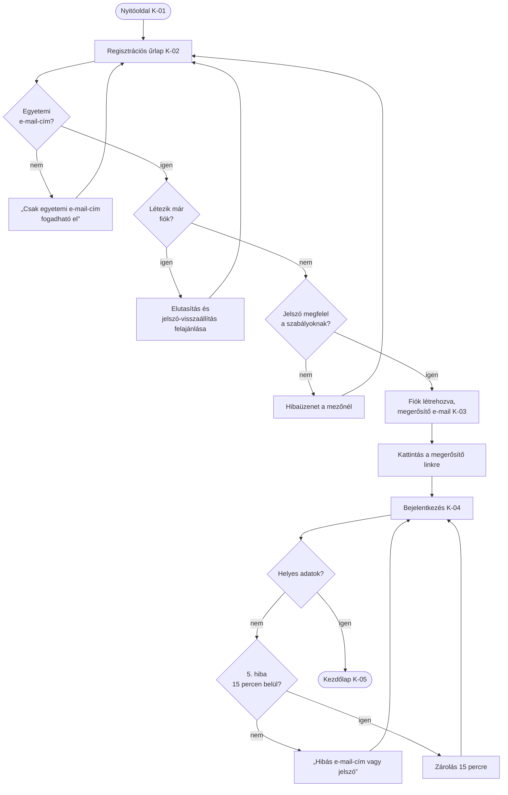
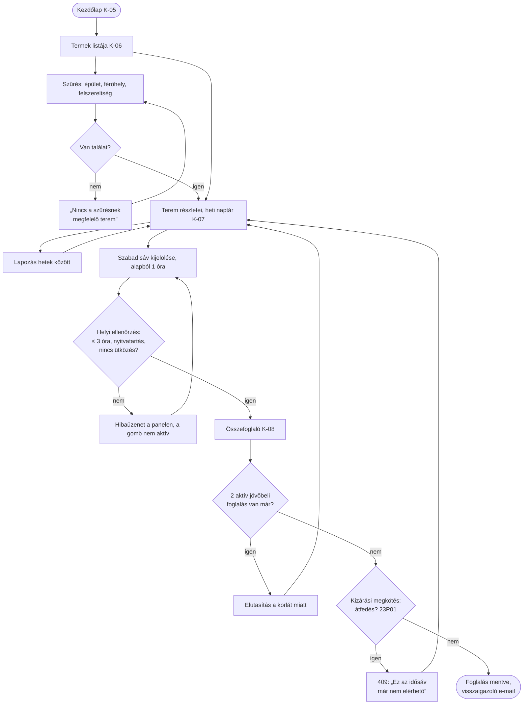
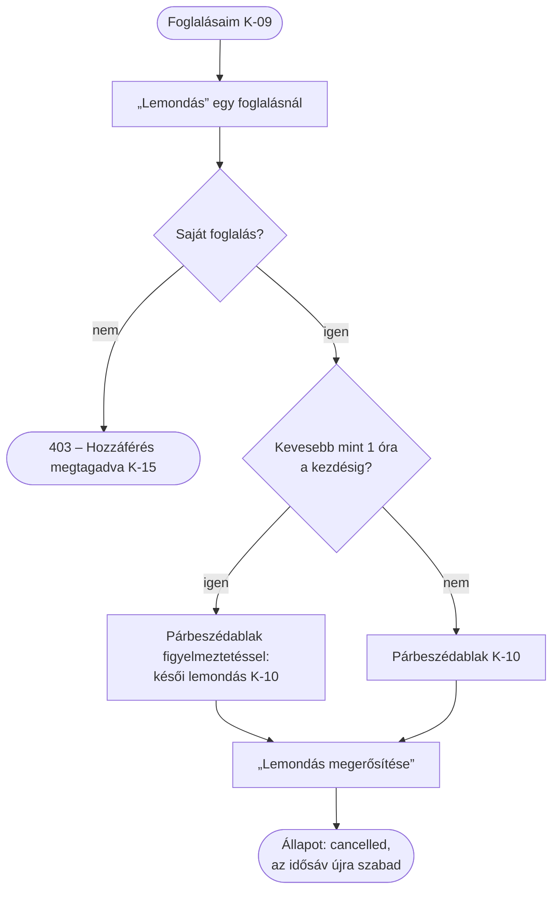
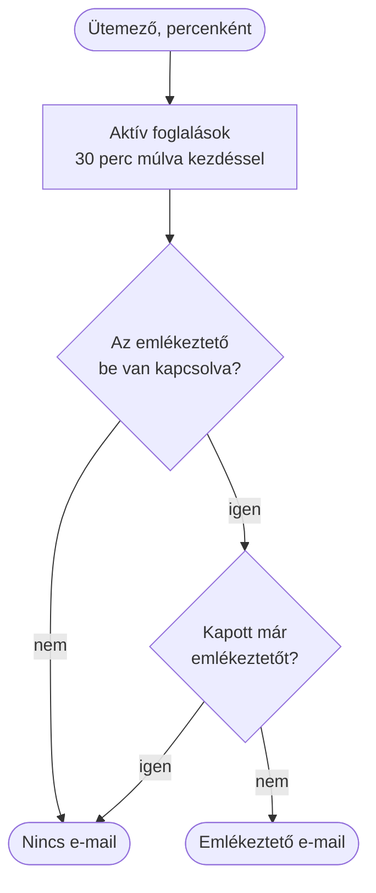
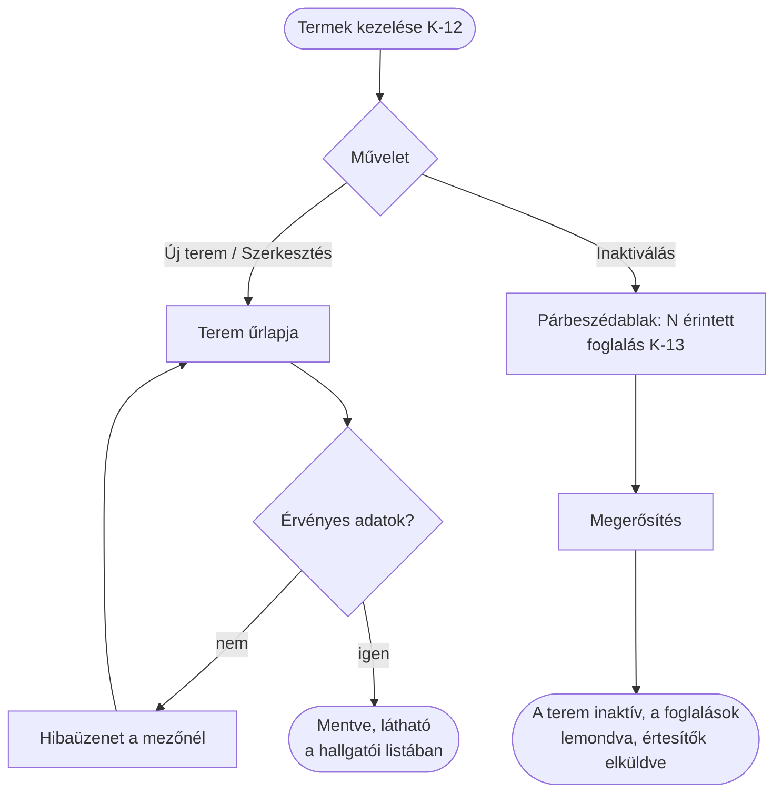

# Felhasználói folyamatok (user flow) – StudyRoom

Ez a dokumentum lépésről lépésre leírja, hogyan halad végig a felhasználó a StudyRoom fő tevékenységein: mit csinál, hogyan válaszol a rendszer, és melyik képernyőn történik mindez. A folyamatok a [követelményekre](../requirements.md) épülnek, a lépéseknél zárójelben szerepel a kapcsolódó elfogadási kritérium. A képernyők a [kattintható prototípusban](prototipus.html) is megnézhetők.

## Tartalomjegyzék

1. [Képernyők](#képernyők)
2. [Jelölések](#jelölések)
3. [UF-01 – Regisztráció és bejelentkezés](#uf-01--regisztráció-és-bejelentkezés)
4. [UF-02 – Terem keresése és lefoglalása (fő folyamat)](#uf-02--terem-keresése-és-lefoglalása-fő-folyamat)
5. [UF-03 – Foglalás lemondása](#uf-03--foglalás-lemondása)
6. [UF-04 – Emlékeztető a foglalás előtt](#uf-04--emlékeztető-a-foglalás-előtt)
7. [UF-05 – Termek kezelése (adminisztrátor)](#uf-05--termek-kezelése-adminisztrátor)
8. [UF-06 – Kihasználtsági statisztika és CSV-export (adminisztrátor)](#uf-06--kihasználtsági-statisztika-és-csv-export-adminisztrátor)
9. [UF-07 – Adatexport és fióktörlés](#uf-07--adatexport-és-fióktörlés)
10. [NFR-07 ellenőrzése: kattintások száma a foglalásig](#nfr-07-ellenőrzése-kattintások-száma-a-foglalásig)

---

## Képernyők

| Azonosító | Képernyő | Szerepkör | Követelmények |
|---|---|---|---|
| K-01 | Nyitóoldal | Vendég | – |
| K-02 | Regisztráció | Vendég | FR-01 |
| K-03 | Regisztráció visszaigazolása („Nézd meg a postafiókodat”) | Vendég | AC-01.1 |
| K-04 | Bejelentkezés | Vendég | FR-02 |
| K-05 | Kezdőlap (dashboard) | Hallgató | AC-02.1, FR-07 |
| K-06 | Termek (lista és szűrők) | Hallgató | FR-03 |
| K-07 | Terem részletei (heti naptár és foglalási panel) | Hallgató | FR-04, FR-05 |
| K-08 | Foglalás megerősítése (párbeszédablak) | Hallgató | FR-05 |
| K-09 | Foglalásaim (Közelgő / Előzmények) | Hallgató | FR-07 |
| K-10 | Lemondás megerősítése (párbeszédablak) | Hallgató | FR-06 |
| K-11 | Profil és beállítások | Hallgató | AC-08.2, NFR-04 |
| K-12 | Termek kezelése (lista és szerkesztő) | Adminisztrátor | FR-09 |
| K-13 | Terem inaktiválása (párbeszédablak) | Adminisztrátor | AC-09.2 |
| K-14 | Statisztikák | Adminisztrátor | FR-10 |
| K-15 | 403 – Hozzáférés megtagadva | Hallgató | AC-06.3, AC-09.3 |

A fejléc menüje szerepkörönként más:

- **Vendég:** Bejelentkezés, Regisztráció
- **Hallgató:** Kezdőlap, Termek, Foglalásaim, Profil, Kijelentkezés
- **Adminisztrátor:** Termek kezelése, Statisztikák, Kijelentkezés

Minden képernyőn elérhető a HU / EN nyelvváltó (NFR-07).

## Jelölések

A folyamatábrákon a lekerekített téglalap a kezdő- és végpont, a téglalap egy képernyő vagy egy felhasználói lépés, a rombusz a rendszer döntése. A hibaágak végén a felhasználó ugyanarra a képernyőre kerül vissza, a hibaüzenettel együtt.

---

## UF-01 – Regisztráció és bejelentkezés

| | |
|---|---|
| **Szereplő** | Vendég, aki ezután Hallgató lesz |
| **Cél** | Fiókot hoz létre, és bejelentkezik |
| **Belépési pont** | K-01 Nyitóoldal, „Regisztráció” gomb |
| **Előfeltétel** | Van egyetemi e-mail-címe (`@*.nye.hu`) |
| **Sikeres kimenet** | Bejelentkezve a K-05 Kezdőlapra kerül |
| **Követelmények** | FR-01, FR-02 |

### Fő út

| # | A felhasználó | A rendszer | Képernyő |
|---|---|---|---|
| 1 | A nyitóoldalon a „Regisztráció” gombra kattint. | Megnyitja a regisztrációs űrlapot. | K-01 → K-02 |
| 2 | Megadja a nevét, az egyetemi e-mail-címét és kétszer a jelszavát, majd elfogadja az adatkezelési tájékoztatót. | Gépelés közben mutatja, hogy a jelszó teljesíti-e a szabályokat: legalább 10 karakter, van benne betű és számjegy (NFR-03). | K-02 |
| 3 | A „Fiók létrehozása” gombra kattint. | Ellenőrzi az e-mail-domaint és azt, hogy létezik-e már fiók ezzel a címmel. Létrehozza a megerősítetlen fiókot, és megerősítő e-mailt küld (AC-01.1). | K-02 → K-03 |
| 4 | Az e-mailben a megerősítő linkre kattint. | Megerősíti a fiókot, és a bejelentkezési oldalra irányít. | K-04 |
| 5 | Megadja az e-mail-címét és a jelszavát, majd a „Bejelentkezés” gombra kattint. | Beléptető munkamenetet hoz létre (AC-02.1). | K-04 → K-05 |

### Alternatív utak és hibák

| Hol | Feltétel | A rendszer válasza |
|---|---|---|
| 3. lépés | Nem egyetemi e-mail-cím | Az űrlap a helyén marad, a mező alatt ez áll: „Csak egyetemi e-mail-cím fogadható el” (AC-01.2). |
| 3. lépés | Már létezik fiók ezzel a címmel | Elutasítja a regisztrációt, és felkínálja a jelszó-visszaállítást (AC-01.3). |
| 3. lépés | A jelszó nem felel meg a szabályoknak, vagy a két jelszó eltér | A hibás mezőnél konkrét üzenetet mutat. |
| 5. lépés | Hibás e-mail-cím vagy jelszó | Általános üzenetet mutat: „Hibás e-mail-cím vagy jelszó”, amely nem árulja el, melyik mező volt hibás (AC-02.2). |
| 5. lépés | 15 percen belül az 5. sikertelen próbálkozás | 15 percre zárolja a bejelentkezést, és kiírja, mikor lehet újra próbálkozni (AC-02.3). |
| Bármikor | A felhasználó a „Kijelentkezés” gombra kattint | Érvényteleníti a munkamenetet, és a nyitóoldalra irányít (AC-02.4). |

---

## UF-02 – Terem keresése és lefoglalása (fő folyamat)

| | |
|---|---|
| **Szereplő** | Hallgató |
| **Cél** | Megtalál egy megfelelő termet, és lefoglal egy szabad idősávot |
| **Belépési pont** | K-05 Kezdőlap, „Terem foglalása” gomb, vagy a menü „Termek” pontja |
| **Előfeltétel** | Be van jelentkezve, és kevesebb mint 2 aktív jövőbeli foglalása van |
| **Sikeres kimenet** | A foglalás létrejön, az idősáv mások számára foglalt lesz, és visszaigazoló e-mailt kap |
| **Követelmények** | FR-03, FR-04, FR-05, ADR-0001 |

### Fő út

| # | A felhasználó | A rendszer | Képernyő |
|---|---|---|---|
| 1 | A kezdőlapon a „Terem foglalása” gombra kattint. | Listázza az összes aktív termet: név, épület, férőhely, felszereltség, és hogy most szabad-e (AC-03.1). | K-05 → K-06 |
| 2 | *(Nem kötelező)* Épületre, minimális férőhelyre vagy felszereltségre szűr. | Azonnal frissíti a listát, és csak azokat a termeket mutatja, amelyek minden feltételnek megfelelnek (AC-03.2). | K-06 |
| 3 | Egy terem kártyájára kattint. | Megnyitja a terem oldalát az aktuális hét naptárával. A foglalt, a már elmúlt és a zárva tartó sávok nem választhatók (AC-04.1, AC-04.3). | K-06 → K-07 |
| 4 | *(Nem kötelező)* A „Következő hét” gombbal lapoz. | Megmutatja a következő hét foglaltságát (AC-04.2). | K-07 |
| 5 | Egy szabad sávra kattint a naptárban. | Kijelöli a sávot 1 órára. A foglalási panelen mutatja a kezdést, a véget és az időtartamot, és helyben ellenőrzi az ütközést, a nyitvatartást és a 3 órás korlátot. | K-07 |
| 6 | *(Nem kötelező)* Módosítja a kezdést vagy az időtartamot (30 perctől 3 óráig). | Frissíti a kijelölést, és újra ellenőriz. | K-07 |
| 7 | A „Tovább a foglaláshoz” gombra kattint. | Összefoglalót mutat: terem, nap, időpont, időtartam, és hogy kap-e emlékeztetőt. | K-07 → K-08 |
| 8 | A „Foglalás megerősítése” gombra kattint. | Egy tranzakcióban ellenőrzi a felhasználónkénti korlátot, majd menti a foglalást. Az átfedést az adatbázis kizárási megkötése akadályozza meg (ADR-0001). Siker esetén visszajelez, a sávot saját foglalásként jelöli, és visszaigazoló e-mailt küld (AC-05.1). | K-08 → K-07 |

### Alternatív utak és hibák

| Hol | Feltétel | A rendszer válasza |
|---|---|---|
| 2. lépés | Egy terem sem felel meg a szűrésnek | „Nincs a szűrésnek megfelelő terem” üzenetet mutat, és felkínálja a szűrők törlését (AC-03.3). |
| 3. lépés | A terem az adott napon zárva van (pl. vasárnap) | Az egész napot „Zárva” felirattal, nem foglalhatóként mutatja (AC-04.3). |
| 6. lépés | 3 óránál hosszabb időtartam | Kiírja, hogy „A maximális foglalási idő 3 óra”, és a „Tovább” gomb nem aktív (AC-05.3). |
| 6. lépés | A kijelölés foglalt sávba nyúlik, vagy túllép a záráson | Megnevezi az ütközést, és a „Tovább” gomb nem aktív. |
| 8. lépés | Valaki pillanatokkal korábban lefoglalta ugyanazt a sávot | HTTP 409 választ ad, és ezt írja ki: „Ez az idősáv már nem elérhető”. A naptárat frissíti, a sáv foglaltként jelenik meg, és a felhasználó másik sávot választhat (AC-05.2). |
| 8. lépés | Már van 2 aktív jövőbeli foglalása | Elutasítja a foglalást a felhasználónkénti korlát miatt, és a „Foglalásaim” oldalra mutató linket ad (AC-05.4). |

---

## UF-03 – Foglalás lemondása

| | |
|---|---|
| **Szereplő** | Hallgató |
| **Cél** | Lemond egy foglalást, hogy a terem felszabaduljon |
| **Belépési pont** | K-09 Foglalásaim, vagy a K-05 Kezdőlap közelgő foglalásai |
| **Előfeltétel** | Van aktív jövőbeli foglalása |
| **Sikeres kimenet** | A foglalás `cancelled` állapotba kerül, és az idősáv újra szabad |
| **Követelmények** | FR-06, FR-07, ADR-0001 |

### Fő út

| # | A felhasználó | A rendszer | Képernyő |
|---|---|---|---|
| 1 | A menüben a „Foglalásaim” pontra kattint. | Kezdés szerint rendezve listázza a közelgő foglalásait (AC-07.1). | K-09 |
| 2 | Egy foglalásnál a „Lemondás” gombra kattint. | Megerősítést kér, és mutatja a foglalás adatait. | K-09 → K-10 |
| 3 | A „Lemondás megerősítése” gombra kattint. | A foglalást `cancelled` állapotba teszi (nem törli fizikailag), az idősávot felszabadítja, és visszajelez (AC-06.1). | K-10 → K-09 |

### Alternatív utak és hibák

| Hol | Feltétel | A rendszer válasza |
|---|---|---|
| 2. lépés | A kezdésig kevesebb mint 1 óra van hátra | A párbeszédablak figyelmeztet, hogy a lemondást késői lemondásként rögzíti. Megerősítés után a lemondás megtörténik, `late_cancellation = true` jelöléssel (AC-06.2). |
| Bármikor | Az „Előzmények” fülre vált | Megmutatja az elmúlt 90 nap foglalásait, köztük a lezajlott és a lemondott foglalásokat (AC-07.2). |
| Bármikor | Más felhasználó foglalását próbálja lemondani, pl. közvetlen URL-lel | 403-as választ ad, és a K-15 oldalra irányít (AC-06.3). |

---

## UF-04 – Emlékeztető a foglalás előtt

| | |
|---|---|
| **Szereplő** | Hallgató, valamint az Ütemező és az E-mail szolgáltatás mint rendszerszereplők |
| **Cél** | A hallgató nem felejti el a foglalását |
| **Belépési pont** | Az ütemezett feladat percenként fut, a beállítás a K-11 Profil oldalon van |
| **Követelmények** | FR-08 |

### Fő út

| # | Szereplő | Tevékenység | Képernyő |
|---|---|---|---|
| 1 | Ütemező | Megkeresi azokat az aktív foglalásokat, amelyek 30 perc múlva kezdődnek, és még nem kaptak emlékeztetőt. | – |
| 2 | Ütemező | Kihagyja azokat a felhasználókat, akik kikapcsolták az emlékeztetőt (AC-08.2). | – |
| 3 | E-mail szolgáltatás | Elküldi az emlékeztetőt a terem nevével, helyével és az időponttal (AC-08.1). | – |
| 4 | Hallgató | Az e-mailben a „Foglalás megtekintése” linkre kattint. | K-09 |

### A beállítás módosítása

| # | A felhasználó | A rendszer | Képernyő |
|---|---|---|---|
| 1 | A menüben a „Profil” pontra kattint. | Megmutatja a fiókadatokat és az értesítési beállításokat. | K-11 |
| 2 | Kikapcsolja az „Emlékeztető e-mail 30 perccel a kezdés előtt” kapcsolót. | Azonnal menti a beállítást, és visszajelez. A változás a már meglévő foglalásokra is érvényes. | K-11 |

---

## UF-05 – Termek kezelése (adminisztrátor)

| | |
|---|---|
| **Szereplő** | Adminisztrátor |
| **Cél** | A teremlista a valóságot tükrözi: új termet vesz fel, adatot módosít, vagy inaktivál egy termet |
| **Belépési pont** | Bejelentkezés után a K-12 Termek kezelése oldal |
| **Követelmények** | FR-09, ADR-0001 |

### Fő út: új terem létrehozása

| # | Az adminisztrátor | A rendszer | Képernyő |
|---|---|---|---|
| 1 | Az „Új terem” gombra kattint. | Megnyitja a terem űrlapját. | K-12 |
| 2 | Megadja a terem kódját, nevét, épületét, férőhelyét, felszereltségét és nyitvatartását. | Ellenőrzi, hogy minden kötelező mező ki van-e töltve, a kód egyedi-e, és a férőhely 1 és 200 közé esik-e. | K-12 |
| 3 | A „Mentés” gombra kattint. | Elmenti a termet, amely azonnal megjelenik a hallgatók teremlistájában (AC-09.1). | K-12 |

### Fő út: terem inaktiválása

| # | Az adminisztrátor | A rendszer | Képernyő |
|---|---|---|---|
| 1 | Egy teremnél az „Inaktiválás” gombra kattint. | Megmutatja, hány jövőbeli foglalást érint a művelet, és hogy az érintett hallgatók értesítést kapnak. | K-12 → K-13 |
| 2 | Az „Inaktiválás és foglalások lemondása” gombra kattint. | A termet inaktívvá teszi, így eltűnik a hallgatói listából. A jövőbeli foglalásait `cancelled` állapotba teszi, és értesítő e-mailt küld az érintett hallgatóknak (AC-09.2). | K-13 → K-12 |

### Alternatív utak és hibák

| Hol | Feltétel | A rendszer válasza |
|---|---|---|
| Bármikor | Hallgató nyitja meg a teremkezelő oldalt | 403-as választ ad, és a K-15 oldalra irányít (AC-09.3). |
| Inaktiválás, 1. lépés | Nincs jövőbeli foglalás | A párbeszédablak ezt írja ki: „Ehhez a teremhez nincs jövőbeli foglalás”. |
| Bármikor | Inaktív teremnél az „Újraaktiválás” gombra kattint | A terem újra megjelenik a hallgatói listában. A lemondott foglalások nem állnak vissza. |

---

## UF-06 – Kihasználtsági statisztika és CSV-export (adminisztrátor)

| | |
|---|---|
| **Szereplő** | Adminisztrátor |
| **Cél** | Látja, mennyire vannak kihasználva a termek, és továbbadja az adatokat |
| **Belépési pont** | A menü „Statisztikák” pontja, K-14 |
| **Követelmények** | FR-10 |

### Fő út

| # | Az adminisztrátor | A rendszer | Képernyő |
|---|---|---|---|
| 1 | A menüben a „Statisztikák” pontra kattint. | Alapértelmezésként az előző hét adatait mutatja. | K-14 |
| 2 | Kiválaszt egy időszakot: előre megadott időszakot (előző hét, elmúlt 30 nap) vagy egyéni kezdő- és záró dátumot. | Termenként kiszámolja a kihasználtságot: a foglalt órák és a nyitvatartási órák arányát, százalékban (AC-10.1). | K-14 |
| 3 | A „CSV exportálás” gombra kattint. | Letölti a megjelenített adatokat CSV-fájlként: pontosvessző az elválasztó, tizedesvessző a tizedesjel, UTF-8 kódolás, hogy a magyar Excel helyesen nyissa meg (AC-10.2). | K-14 |

| Hol | Feltétel | A rendszer válasza |
|---|---|---|
| 2. lépés | A záró dátum a kezdő dátum előtt van | Kiírja: „A záró dátum nem lehet korábbi a kezdő dátumnál”, és nem számol. |
| 2. lépés | Az időszakban nincs foglalás | Minden teremnél 0% látszik. Az export ilyenkor is elérhető. |

---

## UF-07 – Adatexport és fióktörlés

| | |
|---|---|
| **Szereplő** | Hallgató |
| **Cél** | Kikéri a róla tárolt adatokat, vagy törli a fiókját |
| **Belépési pont** | K-11 Profil, „Adataim” szakasz |
| **Követelmények** | NFR-04 |

| # | A felhasználó | A rendszer | Képernyő |
|---|---|---|---|
| 1 | Az „Adataim exportálása” gombra kattint. | Elkészíti az exportot (név, e-mail-cím, foglalások), és letöltési linket küld e-mailben. | K-11 |
| 2 | A „Fiók törlése” gombra kattint. | Megerősítést kér, és elmagyarázza, hogy a jövőbeli foglalások lemondásra kerülnek, a személyes adatokat pedig 30 napon belül törli vagy anonimizálja. | K-11 |
| 3 | A „Fiók végleges törlése” gombra kattint. | Lemondja a jövőbeli foglalásokat, kijelentkezteti a felhasználót, és a nyitóoldalra irányít. | K-01 |

---

## NFR-07 ellenőrzése: kattintások száma a foglalásig

Az NFR-07 szerint egy új felhasználónak a nyitóoldaltól legfeljebb 5 kattintással kell foglalást létrehoznia. A bejelentkezett hallgató nyitóoldala a K-05 Kezdőlap. A legrövidebb út:

| Kattintás | Elem | Képernyő |
|---|---|---|
| 1 | „Terem foglalása” gomb | K-05 |
| 2 | Egy terem kártyája | K-06 |
| 3 | Egy szabad sáv a naptárban, amely automatikusan 1 órára jelölődik ki | K-07 |
| 4 | „Tovább a foglaláshoz” | K-07 |
| 5 | „Foglalás megerősítése” | K-08 |

A szűrés és az időtartam módosítása nem kötelező, így a fő út pontosan 5 kattintás. Ehhez két tervezési döntés kell: a sáv kijelölése egyetlen kattintás, alapértelmezett időtartammal, és a foglalási panel ugyanazon a képernyőn jelenik meg, mint a naptár. A prototípus felső sávjában lévő számláló a kezdőlaptól számolja a kattintásokat, így a használhatósági teszten ez közvetlenül mérhető.
